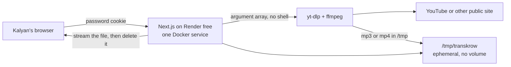

# System design

## Feasibility

Render's free web service hosts this downloader for $0. It fetches a video or audio file from YouTube or a similar public site so Transkrow can transcribe it with the tools they already use.

VidBee (https://github.com/nexmoe/VidBee) is MIT-licensed, Copyright (c) 2025 VidBee. The license allows copying, modification, and self-hosting, including commercial use, as long as the copyright and permission notice stay with the code. That notice is in [THIRD_PARTY_NOTICES.md](THIRD_PARTY_NOTICES.md).

VidBee is not desktop-only. The current repository also contains:

- `apps/desktop` — Electron app, local Whisper-class transcription, AI prompts
- `apps/api` — Fastify server, SQLite (`better-sqlite3`), yt-dlp, FFmpeg
- `apps/web` — TanStack Start client that talks to the API
- `packages/downloader-core` — shared yt-dlp argument builder and process wrapper
- `packages/transcription` — local speech-recognition workers (sherpa by default)

`docker compose` already runs the API and the web UI as two containers. Storage is a SQLite file plus a download directory. No paid database is required.

Running that stack unchanged on a free 512 MB instance is a poor fit:

| Upstream behavior | Why it hurts a free 512 MB web service |
| --- | --- |
| Two services (web on 3000, API on 3100) | Two processes, and the free plan is one instance |
| No password on the API (`cors` origin is open, `/health` and the RPC routes are public) | Anyone who finds the URL can burn the 750 free hours |
| Transcription executor defaults to sherpa | Model downloads and RAM that Transkrow does not need, because transcription already happens elsewhere |
| No download size, duration, or retention limits | A playlist or a livestream can fill `/tmp` and the 512 MB memory |
| yt-dlp is spawned with an argument array (this part is already safe) | We keep that property |

This repository is therefore one Node.js service that does the download slice only. It is not a drop-in fork of the VidBee UI. The engine is the same: an official yt-dlp binary and Debian FFmpeg, invoked with `execFile` and `shell: false`.

## Architecture

One Render free web service (`render.yaml`). No database and no persistent disk. The job list is a JSON file under `/tmp/transkrow`. Media for an in-progress download is in `/tmp/transkrow/downloads/<job-id>/`. The save route streams that file to the browser and deletes it when the transfer finishes. A timer deletes anything still there after `DELETE_AFTER_MINUTES` (default 15). Spin-down, restart, and redeploy wipe `/tmp` immediately. A sleeping service does not remember unfinished work.

## Data flow

1. The browser signs in with `AUTH_PASSWORD`. The server sets an HTTP-only cookie signed with `AUTH_SECRET`.
2. The desk sends `{ url, mode, playlist }` to `POST /api/jobs`.
3. The server rejects anything that is not `http` or `https`, rejects hostnames such as `localhost` and `metadata.google.internal`, resolves DNS, and rejects the URL if any address is loopback, private, link-local, CGNAT, or documentation space.
4. The server builds a fixed yt-dlp argument list. The URL is one argument after `--`. Format, playlist length, file size, and duration come from server settings, not from the request body, except for the audio/video choice and the playlist checkbox.
5. yt-dlp writes into that job's directory. ffmpeg extracts MP3 or merges MP4. ffprobe checks duration again after the file exists.
6. The desk polls `GET /api/jobs` and offers a save link. The file route checks the session, the job id, and the file name, then streams the bytes without loading the whole file into memory. When the stream ends, that file is deleted. If it was the last file for the job, the job directory is removed too.
7. A timer deletes anything the browser never finished saving. The owner can also delete a finished job immediately.

## Security

- Single shared password. There is no account database. The cookie is HTTP-only, `SameSite=Lax`, and `Secure` on HTTPS. The password is compared by hashing both sides and using a constant-time compare.
- Login attempts and new downloads are rate-limited in memory. This assumes one replica, which is all the Render free plan allows. The limits reset when the instance sleeps.
- POST requests with an `Origin` header must match the host. The forwarded host is used for redirects.
- Secrets (`AUTH_PASSWORD`, `AUTH_SECRET`, `COOKIES_CONTENT`) are read from the environment and are removed from the environment passed to yt-dlp.
- yt-dlp is never started through a shell. `--ignore-config` stops a config file from adding arguments. User text cannot choose extra flags.
- File names that leave the job directory, start with a dot, or are not a known media extension are not served.
- Caps, chosen for 512 MB of RAM: duration (default 90 minutes), file size (default 150 MB), playlist length (default 3, and only if the box is checked), one download at a time, and 400 MB of files in `/tmp`.
- Live streams are filtered out (`!is_live`).
- Health (`GET /api/health`) is unauthenticated so Render can probe it. It returns process liveness and the yt-dlp/ffmpeg version strings. It does not list jobs or files.

Residual risk: yt-dlp follows redirects itself. The URL check runs before the process starts. A public host that later redirects to a private address is not re-checked. The service is password-protected and only Kalyan should be signed in, which makes that a much smaller issue than an open proxy. It is still not a general-purpose SSRF appliance and should not be exposed without the password.

## YouTube on a datacenter address

YouTube often refuses or throttles downloads from hosting providers, including Render. A failure shows up as a bot-check or "sign in" error in the desk. Two mitigations are supported, and both are environment variables rather than form fields:

1. `COOKIES_FILE` or `COOKIES_CONTENT` — a Netscape `cookies.txt` exported from a browser that is already signed into YouTube. Treat it as a password. It can expire and it grants access to that Google account's sessions.
2. `YTDLP_PROXY` — an `http`, `https`, or `socks5` proxy. A residential or ISP proxy works more often than another datacenter proxy.

The image pins yt-dlp `2026.10.26` and passes Node as the JavaScript runtime (`--js-runtimes`) so YouTube's signature challenges can be solved. When YouTube changes again, bump `YT_DLP_VERSION` and `YT_DLP_SHA256` in the Dockerfile and redeploy.

## Cost

**$0 per month** on Render's free web service.

Figures below are from https://render.com/pricing and https://render.com/docs/free as checked on 2 November 2026:

| Limit | What it means here |
| --- | --- |
| $0, 512 MB RAM | One Docker web service. Audio is the safe choice. A video merge can still be killed if ffmpeg exceeds the memory. |
| Spins down after 15 idle minutes | The next visit waits about a minute. `/tmp` is wiped, so the desk starts empty. |
| Ephemeral filesystem, no persistent disk | No volume and no database. Downloads are streamed, then deleted. |
| 750 free instance hours per workspace each month | Sleeping time does not count. A desk used on workdays stays inside this. If the hours run out, Render suspends the service until next month. |
| One instance | In-memory rate limits are enough. Do not scale past one. |

Hugging Face Docker Spaces and Koyeb's free instance are fallbacks, also at $0 if the free hardware is offered. They have the same shape: one container, no paid disk, files only in `/tmp`. Details are in [DEPLOY.md](DEPLOY.md). There is no database charge on any of these.

## What was deliberately left out

Local transcription, RSS subscriptions, the browser extension, and the Electron app stay in VidBee. Transkrow already has a transcription business, and those pieces are what make the upstream image large and the API memory-hungry.
